# krill · tests

Quick results per batch. Screenshots live in `docs/tests/`. Run everything with
`node tests/run.js`.

**Test creatures:** use **Siltclicker** (Dolphin + Mouth) as the default test creature. Use
Moanback only when checking that a long, monotonous call works, or when a test needs a
Throat + Mouth creature.

**Now: 94 Node tests passing** (about 40 s, most of it the audio tests), plus **59 browser checks**
(`node tools/check-pages.js`, needs Playwright).

## Batch 01 · setup and engines

- Vendored Throat, Dolphin and mouth-tube load in Node and make sound. ✓
- Each vendored file matches its recorded SHA-256, so an accidental edit fails. ✓
- Engines are deterministic for a seed. ✓
- Speed check, one voice at 48 kHz: Throat ≈ 4% of a core, Dolphin ≈ 3%, Throat + tube ≈ 12%.

## Batch 02 · creature format

- Krill's parameter table matches every engine parameter (min, max, default, step). ✓
- Defaults for all four species load with no warnings; one example creature per species. ✓
- Repairs work: clamping, swapped ranges, whole-number rounding, bad types, unknown keys kept. ✓
- Save → load → save is byte-identical. ✓

## Batch 03 · one creature, score

- Same seed, same score; another seed differs. ✓
- 30 minutes per example: every value stays inside its range (units, lengths, gaps, rests,
  envelopes, pitches, parameters). ✓
- In key: every anchor, contour end, Dolphin pulse pitch, whistle transpose and sweep end is on
  the scale. Free mode is continuous (> 90% fractional pitches). ✓
- Signature with variation 0 repeats the same shape in any pond (compared by scale degree). ✓
- Copying across species keeps the gesture: same lengths, mapped into the copier's ranges. ✓
- Harmonise with D and A sounding: F jumps from 18% to 56% of picks (completes D minor). ✓
- An hour of score per creature: 3–60 ms.
- **Bug found:** seed hashing ignored argument order (slot 2 re-roll 1 = slot 1 re-roll 2).
  Fixed before any pond files existed; 300 slot streams now all distinct.

## Batch 04 · one creature, audio

Glassfin whistles with contours, Moanback breathy voiced calls, Ticker click trains, Wicklace
short buzzes. Rests are exact digital silence.

- Measured pitch matches the score: steady notes within 0.3% (cents included), a 36-semitone
  glide within about 3 cents with no step where the voice re-bases. Dolphin whistle and bend
  contour also land. ✓
- Output is identical for chunk sizes 1, 32 and 4801, and between runs. ✓
- Limiter: loud input never passes -1 dBFS; quiet input passes bit for bit. ✓
- WAV header, sizes and the `krll` metadata chunk parse back; 16-bit dither repeats. ✓
- Onsets carry no extra high-frequency energy (no clicks at unit starts); the vertical lines in
  Glassfin's spectrogram are Dolphin's own pulse clicks.
- Speed while calling: bare Throat 26 ms per second of audio, bare Dolphin 31, Throat + tube
  62, Dolphin + tube 88. Asleep: nothing. Examples render 30–290× real time.
- **Bug found: the tube clamped.** mouth-tube limits its output to ±1 and adds 20 dB or more of
  peak gain on clicks. Moanback was flat-topped:

  

  Fixed with headroom inside the engines (added back in the voice). Now every example stays at
  least 19 dB clear of an engine clamp (test requires 6 dB):

  

- **Bug found: loudness per species.** At the same Level, Dolphin + tube was about 30 dB louder
  than bare Dolphin. Calibrated so Level 0 is about -20 dBFS RMS while calling:

  | Species | Before | After |
  |---|---|---|
  | Throat | -24.7 dB | -19.8 dB |
  | Throat + tube | -12.6 dB | -20.3 dB |
  | Dolphin | -19.4 dB | -20.0 dB |
  | Dolphin + tube | +12.1 dB | -19.8 dB |

- Listening check (you): passed.

## Batch 05 · creature page

- Browser check in headless Chromium, 20 of 20: page loads, 39 range sliders and 10 knobs build,
  Call renders in the worker and plays (about 0.3 s per call), all four examples call, range
  drag edits the creature and marks it changed, double-click locks, drawing on the vowel pad
  sets both tongue ranges, switching species rebuilds the source panel, Signature in free mode,
  Save downloads a file that loads back cleanly, Render 60 s solo downloads a valid WAV in
  about 1 s, the creature survives a reload, no console
  errors. ✓
- Node: the built page is current, previews repeat for a seed, the Signature button plays the
  signature, a 1.5 kHz tone lands in its spectrogram bin, the solo WAV is complete. ✓

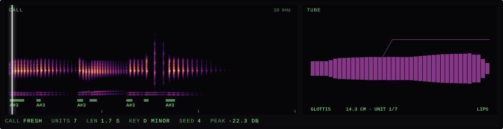

- **Fixed while testing:** the page read the creature before one existed (blank page);
  Dolphin's sliders were cramped three to a row (now two); the spectrogram's fixed -110 dB floor
  lit up Dolphin's faint click noise, so colours now follow each call's own peak (60 dB window).

### After your review

- **Parts registry:** sources and bodies moved into `src/parts.js`; voice, score, page and tools
  no longer name an engine. Audio tests (measured pitch, calibration, headroom, chunk sizes)
  passed unchanged, so the sound didn't move. New test: every part is complete. ✓
- **Creature format 2:** `body` replaces `mouth`, tube ranges are `tube.*`; version 1 files
  migrate on load (Node and in the page). The four examples are migrated. ✓
- **Low-pass:** off is bit-identical to no filter and creates nothing; on at 1 kHz cuts the band
  around 4 kHz to the bottom of the 60 dB window while the voice stays; unity gain at DC. ✓
- Phone layout dropped (desktop only, min width 960 px).

## Batch 06 · conductor (and 07 · pond render)

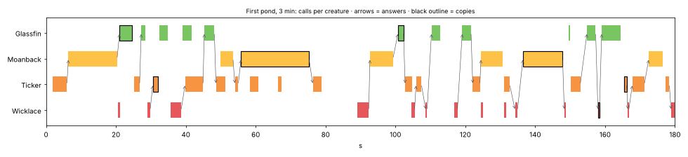

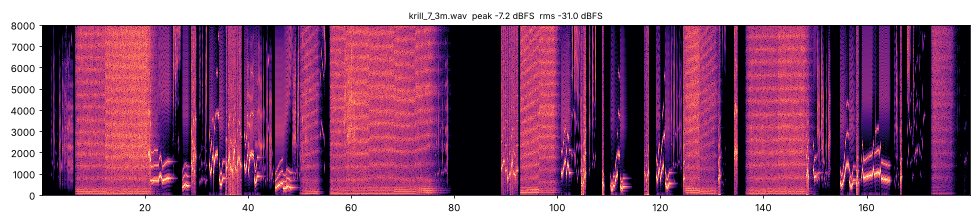

- Same pond, same score; another seed differs. Pond files repair and keep unknown keys. ✓
- Overlap 0: no two calls overlap at all; Overlap 1: plenty do. A creature never overlaps
  itself. ✓
- Responsive 0: no answers; Talkative 0 as well: only the opening call. ✓
- Mimicry 1: copies carry their source's lineage, and lineages reach three creatures. A lone
  creature copies itself. Answer chains end. ✓
- Answers lean away from their caller; re-rolling a slot changes that creature. ✓
- Eras: density and register drift within bounds. ✓
- An hour of a six-creature pond is decided in about 60 ms.
- A pond render doesn't depend on chunk size, every creature sounds, all engines keep 6 dB+ of
  headroom. ✓
- **Bug found: Harmonise was undone by the era's Register**, which shifted the chosen start after
  Harmonise picked it. Register now narrows the allowed starts instead. With Overlap 1 in a
  40-minute pond, consonant starts went from 59% vs 55% (off) to **92% vs 60%**.
- **Added after your review:** per lane *Ignore others* and a *loudness range* [low, 0] dB. An
  ignoring lane never answers, is never answered or copied, and talks over the others while they
  still take strict turns; Talkative 0.1 vs 0.8 gives clearly fewer calls. With a range of
  -12 to 0 every call lands inside it (spread over 6 dB), never above 0; low 0 keeps every call
  level; a -24 to 0 lane is clearly quieter in the mix. ✓
- Siltclicker added as a factory preset; it replaces Moanback in the example pond and in tests.
  Its file showed a page bug: a log slider's rounding could step just below the range (Click
  width 0.04995 vs 0.05). Fixed: sliders clamp after rounding.
- Full 20-minute example pond: 59 s to render (20× real time), 79 MB of memory (streamed to disk),
  header sizes match the 330 MB file, peak -7.2 dBFS, engines 19 dB clear of their clamps.

## Batch 08 · pond page

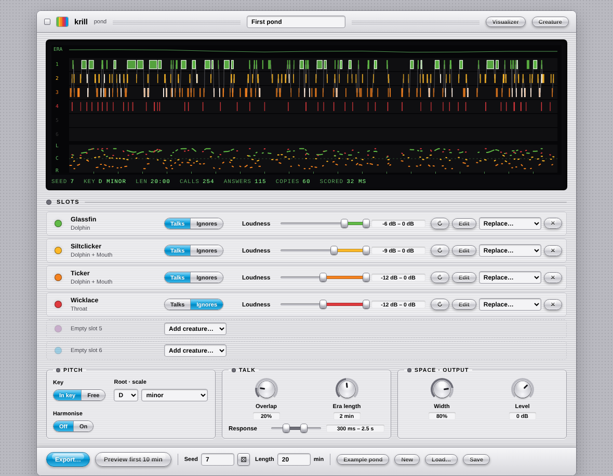

- Browser check, 16 of 16 on the pond page: loads and scores the example pond (254 calls in
  33 ms), draws the sketch, a new seed and a slot re-roll rescore it, Ignores takes a lane out of
  the conversation, adding Siltclicker to an empty slot, the loudness range moves its low end and
  keeps the top at 0, removing a creature, Harmonise, Render preview (30 s rendered in 2.4 s) with
  the player and Download WAV, Save gives a pond that loads back cleanly, long pieces show the
  Node command, the pond survives a reload, Edit opens the creature on the creature page, no
  console errors. ✓
- The creature page's 22 checks still pass; its Pond button now opens the pond page.
- Node: the pond preview renders a pond's first minutes to a complete WAV. ✓
- **Fixed while testing:** the slot loudness and Response sliders were cramped; widened.

### After your review

- **Loudness range, both ends movable:** each call is drawn from [low, high], both at most 0 dB;
  low = high fixes the lane's level. With -18 to -8 every call lands inside it (spread over 5 dB);
  swapped ends sort, a top above 0 clamps to 0. Ponds saved with [low, 0] score and render bit
  for bit as before (2-minute example pond, same SHA-256). Browser: dragging the top handle down
  moves only the top. ✓
- **Bug found: the pan strip didn't show what you hear.** It drew each call at its creature's
  home position only, ignoring wander, in a 34 px strip with no centre, so lanes looked bunched.
  The pan math now lives in `src/pan.js`, used by both the voice and the sketch; the strip is
  taller, has a dashed centre line and draws each call as a line across its duration. Example
  pond: calls span -0.80 to +0.80 (Width 80%) and lanes keep their left-to-right order. The
  voice's output is unchanged (same SHA-256). ✓

## Batch 09 · export

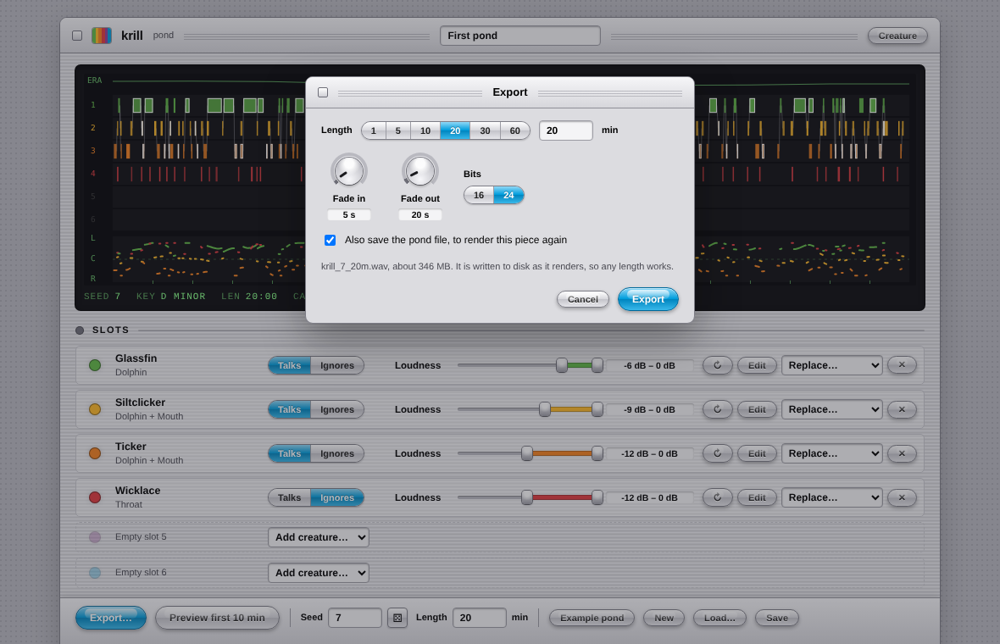

- Same seed, longer length: the first 20 s of a 30-second and a 3-minute render are identical,
  sample for sample (fade-out off). A 5- and 20-minute score agree on all 75 calls in the first
  5 minutes. So a short export is a true preview of a long one. ✓
- The stepped exporter gives the same bytes as the in-memory WAV whatever the step size, and
  knows the file size before it starts. Moving to it left renders bit-identical. ✓
- Browser, streaming path (the save dialog stood in for by a fake file): the sheet has six
  length presets, a custom length, fades and bits; a preset sets the pond's length; a 30-second
  export writes a complete WAV (header written last, sizes match) and saves
  `krill_4242_30s.krill-pond.json` next to it with the export's length. ✓
- Browser, in-memory path (save dialog removed, as in Safari): past 30 minutes Export is
  disabled and the note shows the Node command; a 30-second export downloads a complete WAV;
  loading that WAV opens the pond it was made from (seed, length, all four slots). ✓
- **Fixed while testing:** a krill WAV is recognised by its contents, not its name, since
  downloads can lose the `.wav` extension.
- Not tested here: Safari itself (WebKit can't be installed in this sandbox).

## Batch 10 · visualizer

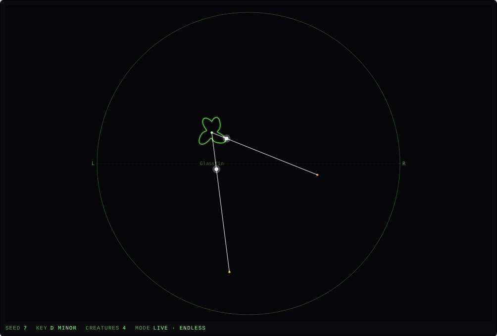

- Scene (Node): the same pond gives the same scene and another seed differs; left to right is
  the voice's own pan (within 0.02, 800+ checks), everyone stays inside the circle; heights are
  seeded per slot and drift with the eras (2× more travel with 30 s eras than 300 s ones); size
  follows the call's loudness (-24 dB lane vs 0 dB) and loudness never moves a creature; an
  answer's ball leaves as the caller ends and arrives as the answer starts, its line then fades;
  dotted lines are always copies. A frame takes microseconds, even six hours in. ✓
- Seek (Node): voices that jump to a point and play on sound close to a straight render (energy
  per second within 3 dB). Only used for pictures; renders are unchanged (same SHA-256). ✓
- Browser, live: Play renders the pond in the AudioWorklet, all four voices send scopes, and the
  scopes keep time with the audio (within 0.1 s). Over 6 s, 237 of 240 samples agree that a
  scope is lit while its creature calls and dark when it's silent. Pause stops time. ✓
- Browser, WAV: a krill WAV opens with its pond and length; the silent voices follow the WAV
  (same second) and pick up again after a seek to 1:00. ✓
- **Fixed while testing:** pages opened from disk refuse a blob URL for the worklet; it now
  falls back to a data: URL. Lines could end in empty space after the caller went quiet; their
  ends are now small dots that fade with the line.
- Not tested here: Safari (WebKit can't be installed in this sandbox).

### After your review

- **The ball is gone:** an answer's line appears as the answer starts and fades over 1.4 s. The
  scene test checks nothing shows before the answer, full brightness at its start, then the fade. ✓
- **Scope styles** (first round): Ring, Line and X/Y, remembered between visits. X/Y's pitch finder lands on
  the period of test tones (220 Hz: 218 samples for 218.2, 1 kHz: 48, 3 kHz: 16). In the pond,
  Glassfin's whistle draws a near-circle, Siltclicker's clicks a decaying spiral and Wicklace's
  buzz a looping shape. The scopes now carry 1024 samples so low voices fit in X/Y. ✓
- **Fixed while testing:** X/Y first drew shapes a third of the size they should be, then flat
  edges where loud peaks hit the limit; it now scales with the voice's level and rounds peaks off.

### Second round: scope styles, names, Chaos

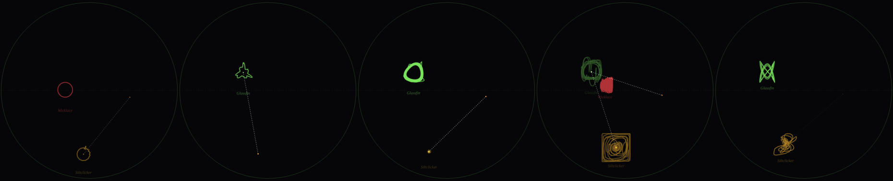

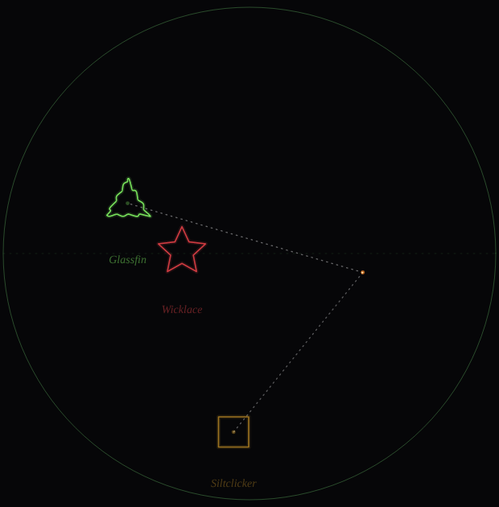

- **Styles:** Line is gone; Ring, Shapes, Loop, Phase and Knot all draw in the browser check, and
  the choice is remembered (an old X/Y choice becomes Loop). Names are italic Times New Roman. ✓
- **Fixed while testing:** Shapes bent so much a triangle read as a flower; it now uses the full
  1024 samples with a gentler bend. Knot drew a standing bar for clicks (no pitch); its tone now
  follows the voice's envelope.
- **Chaos** (Node): Chaos 0 gives the same score as a pond without the setting, and the same
  audio (the 2-minute example's samples are identical; only the pond in the WAV's metadata now
  lists `chaos: 0`). In the example pond, answers go 115 → 190 → 399 and copies 60 → 134 → 330 at
  Chaos 0, 0.5 and 1; calls answered by several creatures 2 → 32 → 74, and those answers start
  within half a second of each other. ✓

## Branch krill-birds-v1: Syrinx and beak-tube

A parallel version, not for main: Syrinx (`701f706`, batch 08) as a source and beak-tube
(`10b865e`, batch 05) as a body named Beak, copied unmodified into `vendor/` with their hashes.

**How they fit**

- *Syrinx* holds one note and moves pitch through its bend (±48 st), like Dolphin. Transpose is
  fixed at 0, so krill's note is the pitch heard at Size 25% (MIDI 96 ≈ 2.1 kHz); Size moves the
  whole bird, so a bigger bird sings lower, and the page's pitch note says where it lands in Hz.
  Mono mode, Sync off; krill drives attack, release and glide as for the others. Duo and
  Independent play one side, since krill holds one note.
- *In key mode* Syrinx's Lock is switched on (Size moves whole octaves, sweeps end on semitones, no
  pitch jitter), and a pattern sweep's end, the Interval side and the Triple membrane land on the
  scale. Bend passes through Lock untouched, so krill's contours stay smooth. Test: in D minor,
  every sweep end, interval and membrane pitch is on the scale. ✓
- *Beak* runs mono; its throat follows the pitch it hears, so it works on all three sources. In
  front of Beak, Syrinx starts with its own Filter off (as on beak-tube's bench); switching a
  Syrinx creature's body to Beak on the creature page does the same.
- *Headroom:* Syrinx's Volume and Beak's Output are turned down 12 dB and added back. Over
  60-second renders of four seeds per species the largest sample inside the engines is 0.135. ✓

**Calibration** (`tools/calibrate.js`, 6 renders per species): throat+beak +31.5 dB,
dolphin+beak −8.5, syrinx+none −3.1, syrinx+tube −30.7, syrinx+beak −4.9; the four old values are
unchanged. Throat through Beak needs a lot: a bird's tract on a voice in the human range passes
little but the top. Syrinx through Mouth has a large crest factor (bird pitches landing on
human-tract resonances), so its loud calls lean on the limiter more than other species.

**Examples** — one for every new pairing:

| Creature | Species | Meant as |
|---|---|---|
| Reedwarbler | Syrinx | a songbird: trills and sweeps handed between the sides |
| Cinderchat | Syrinx | a harsh chatterer: Triple, Jumps and Chaos, short bursts |
| Paleflute | Syrinx + Beak | slow tracked whistles, legato |
| Duskcoo | Syrinx + Beak (Sac) | a dove: Single source, low coos |
| Hollowboom | Syrinx + Beak (Boom) | a huge bird booming |
| Mirelark | Syrinx + Mouth | whistles through vowels |
| Quilltongue | Throat + Beak (Parrot) | a voice in a parrot's head |
| Kelpbeak | Dolphin + Beak | whistles retuned by a bird's throat |

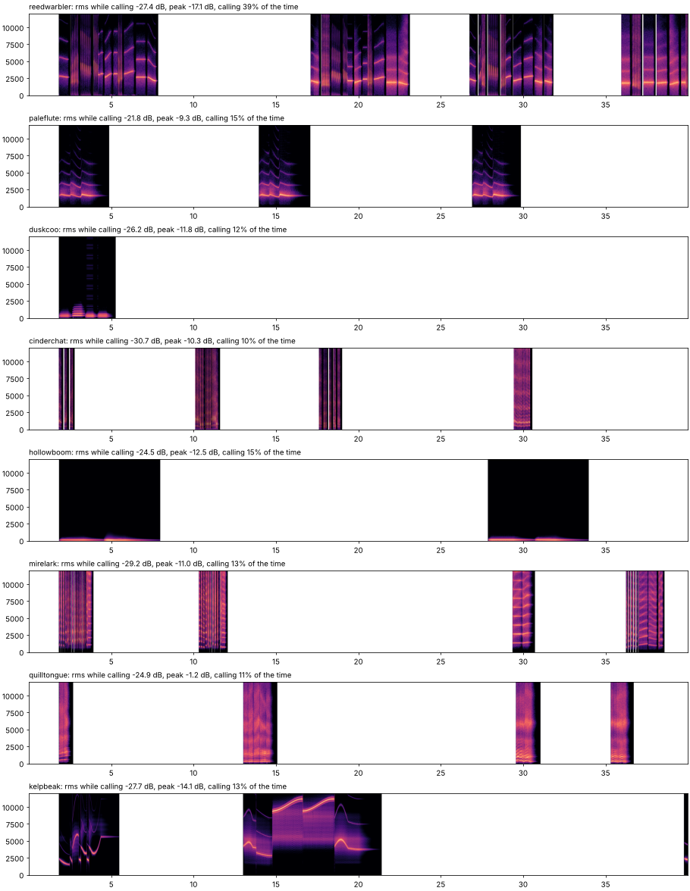

Levels while calling sit between −22 and −31 dB, like the old examples. A minute of any of them
renders in under 2 s. Ponds: *Dawn pond* (six birds, D pentatonic minor, Chaos 20%) and *Shore
pond* (Glassfin and Moanback with four of the new ones). Three minutes render in 19 s and 13 s
(9.4× and 13.8× real time), peak −7.4 and −8.4 dBFS before the limiter. Syrinx is the costly
engine: about 3–11% of a core per sounding voice.

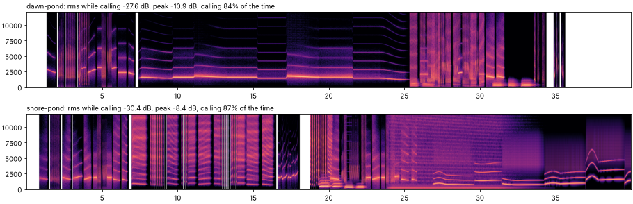

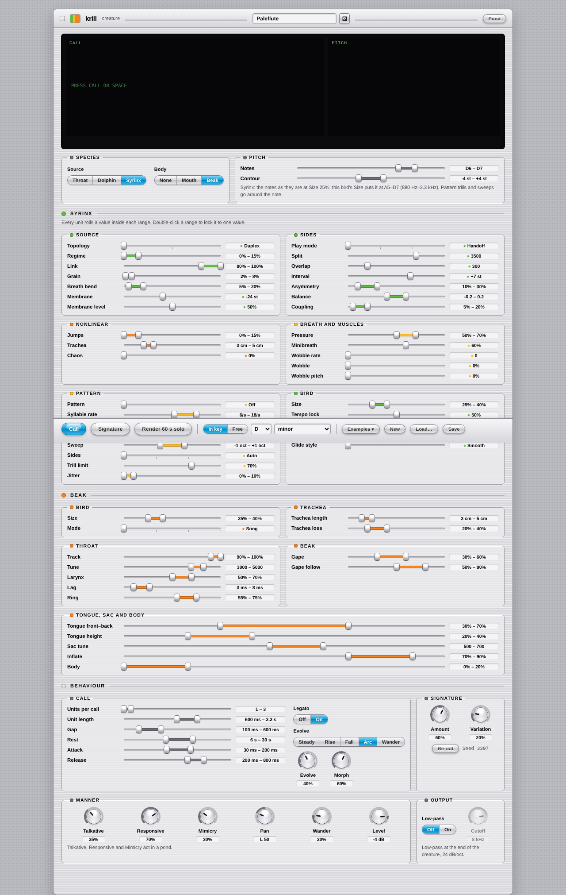

**Fixed while testing** (a krill bug, also on main): a copy or a signature could drop a unit
below the creature's smallest unit count (the largest was already guarded). Cinderchat showed it
(a 1-unit copy with Units 2–6). The guard keeps the random draw where it was, so every call that
was right before is the same: the first pond's 20-minute render is bit-identical to main's. ✓

**Tests:** `node tests/run.js` 98 passed (new: the two engines render and follow the bend, all
nine species are clean, Syrinx key mode, Beak's Filter default). `node tools/check-pages.js` 68
passed: every example calls on the creature page, the pond page carries Dawn pond and its
mechanics are checked on the first pond as before, and the visualizer plays Dawn pond live in the
AudioWorklet with all six scopes. Not tested: Safari, and listening, which is yours.

### Safety limiter per creature

Each creature now ends with its own limiter: source → body → low-pass → **limiter** → pan. It
has zero latency (so timing and the visualizer's scopes don't move), a ceiling of −3 dBFS on what
the creature sends to the mix, drops at once for a block that would pass it and recovers over
0.3 s. Below the ceiling it doesn't touch a sample. A block with NaN or Infinity from an engine is
silenced and counted. `tools/render.js` prints what the limiters did (`creature limiters: idle`,
or the most each lane took off). The mix keeps its own lookahead limiter at −1 dBFS.

- Over 20 minutes of each example pond the loudest creature reaches −6.6 dBFS (Cinderchat), so
  the limiters stay idle on all three ponds, and the first pond's render is still bit-identical
  to main's. ✓
- Tests: three species driven at Level +6 never pass the ceiling; at normal levels the limiter
  takes nothing off; NaN and Infinity blocks come out silent; gain returns to exactly 1. ✓
- `node tests/run.js` 102 passed; `node tools/check-pages.js` 68 passed.
