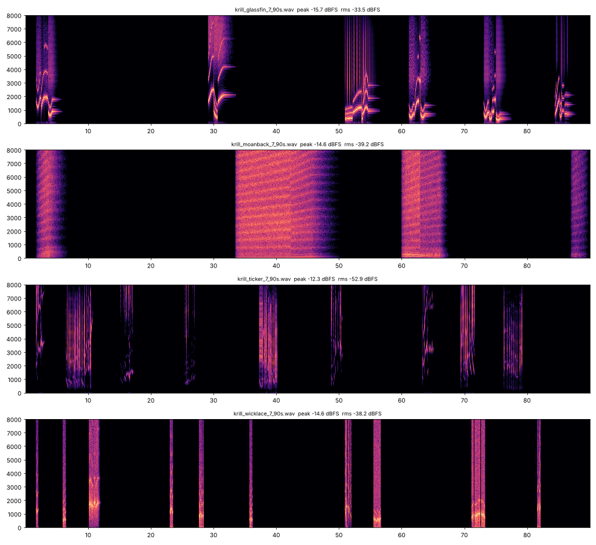
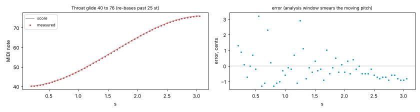
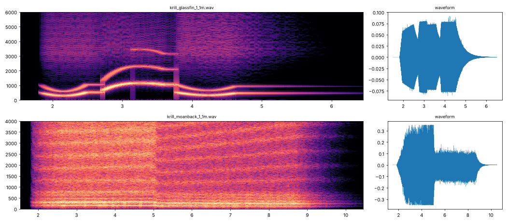
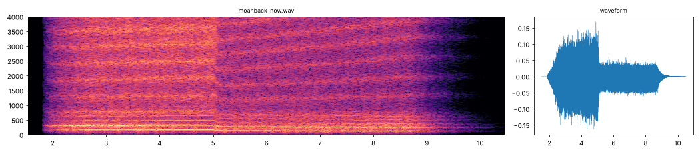
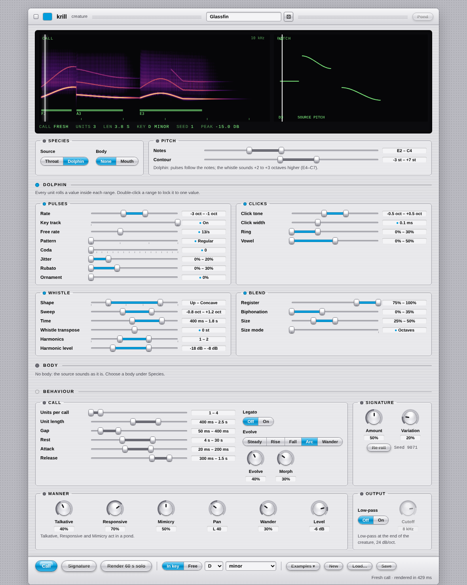
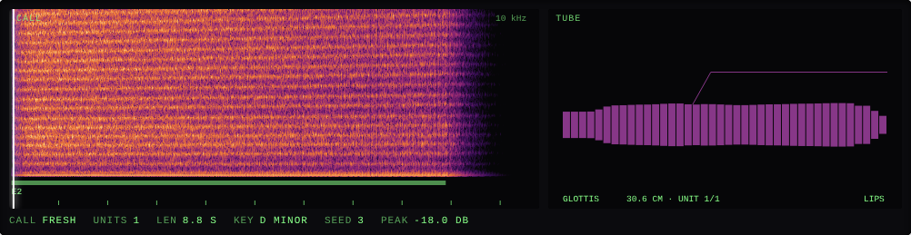
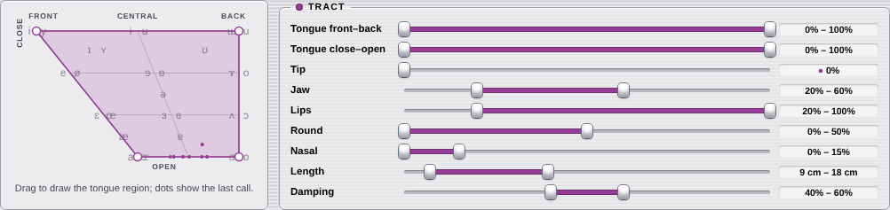

# krill · tests

Quick results per batch. Screenshots live in `docs/tests/`. Run everything with
`node tests/run.js`.

**Now: 62 Node tests passing** (about 19 s, most of it the audio tests), plus **21 browser checks**
(`node tools/check-pages.js`, needs Playwright).

## Batch 01 · setup and engines

- Vendored Throat, Dolphin and mouth-tube load in Node and make sound. ✓
- Each vendored file matches its recorded SHA-256, so an accidental edit fails. ✓
- Engines are deterministic for a seed. ✓
- Speed check, one voice at 48 kHz: Throat ≈ 4% of a core, Dolphin ≈ 3%, Throat + tube ≈ 12%.

## Batch 02 · creature format

- Krill's parameter table matches every engine parameter (min, max, default, step). ✓
- Defaults for all four species load with no warnings; one example creature per species. ✓
- Repairs work: clamping, swapped ranges, whole-number rounding, bad types, unknown keys kept. ✓
- Save → load → save is byte-identical. ✓

## Batch 03 · one creature, score

- Same seed, same score; another seed differs. ✓
- 30 minutes per example: every value stays inside its range (units, lengths, gaps, rests,
  envelopes, pitches, parameters). ✓
- In key: every anchor, contour end, Dolphin pulse pitch, whistle transpose and sweep end is on
  the scale. Free mode is continuous (> 90% fractional pitches). ✓
- Signature with variation 0 repeats the same shape in any pond (compared by scale degree). ✓
- Copying across species keeps the gesture: same lengths, mapped into the copier's ranges. ✓
- Harmonise with D and A sounding: F jumps from 18% to 56% of picks (completes D minor). ✓
- An hour of score per creature: 3–60 ms.
- **Bug found:** seed hashing ignored argument order (slot 2 re-roll 1 = slot 1 re-roll 2).
  Fixed before any pond files existed; 300 slot streams now all distinct.

## Batch 04 · one creature, audio

Glassfin whistles with contours, Moanback breathy voiced calls, Ticker click trains, Wicklace
short buzzes. Rests are exact digital silence.

- Measured pitch matches the score: steady notes within 0.3% (cents included), a 36-semitone
  glide within about 3 cents with no step where the voice re-bases. Dolphin whistle and bend
  contour also land. ✓
- Output is identical for chunk sizes 1, 32 and 4801, and between runs. ✓
- Limiter: loud input never passes -1 dBFS; quiet input passes bit for bit. ✓
- WAV header, sizes and the `krll` metadata chunk parse back; 16-bit dither repeats. ✓
- Onsets carry no extra high-frequency energy (no clicks at unit starts); the vertical lines in
  Glassfin's spectrogram are Dolphin's own pulse clicks.
- Speed while calling: bare Throat 26 ms per second of audio, bare Dolphin 31, Throat + tube
  62, Dolphin + tube 88. Asleep: nothing. Examples render 30–290× real time.
- **Bug found: the tube clamped.** mouth-tube limits its output to ±1 and adds 20 dB or more of
  peak gain on clicks. Moanback was flat-topped:

  

  Fixed with headroom inside the engines (added back in the voice). Now every example stays at
  least 19 dB clear of an engine clamp (test requires 6 dB):

  

- **Bug found: loudness per species.** At the same Level, Dolphin + tube was about 30 dB louder
  than bare Dolphin. Calibrated so Level 0 is about -20 dBFS RMS while calling:

  | Species | Before | After |
  |---|---|---|
  | Throat | -24.7 dB | -19.8 dB |
  | Throat + tube | -12.6 dB | -20.3 dB |
  | Dolphin | -19.4 dB | -20.0 dB |
  | Dolphin + tube | +12.1 dB | -19.8 dB |

- Listening check (you): passed.

## Batch 05 · creature page

- Browser check in headless Chromium, 20 of 20: page loads, 39 range sliders and 10 knobs build,
  Call renders in the worker and plays (about 0.3 s per call), all four examples call, range
  drag edits the creature and marks it changed, double-click locks, drawing on the vowel pad
  sets both tongue ranges, switching species rebuilds the source panel, Signature in free mode,
  Save downloads a file that loads back cleanly, Render 60 s solo downloads a valid WAV in
  about 1 s, the creature survives a reload, no console
  errors. ✓
- Node: the built page is current, previews repeat for a seed, the Signature button plays the
  signature, a 1.5 kHz tone lands in its spectrogram bin, the solo WAV is complete. ✓

- **Fixed while testing:** the page read the creature before one existed (blank page);
  Dolphin's sliders were cramped three to a row (now two); the spectrogram's fixed -110 dB floor
  lit up Dolphin's faint click noise, so colours now follow each call's own peak (60 dB window).

### After your review

- **Parts registry:** sources and bodies moved into `src/parts.js`; voice, score, page and tools
  no longer name an engine. Audio tests (measured pitch, calibration, headroom, chunk sizes)
  passed unchanged, so the sound didn't move. New test: every part is complete. ✓
- **Creature format 2:** `body` replaces `mouth`, tube ranges are `tube.*`; version 1 files
  migrate on load (Node and in the page). The four examples are migrated. ✓
- **Low-pass:** off is bit-identical to no filter and creates nothing; on at 1 kHz cuts the band
  around 4 kHz to the bottom of the 60 dB window while the voice stays; unity gain at DC. ✓
- Phone layout dropped (desktop only, min width 960 px).
